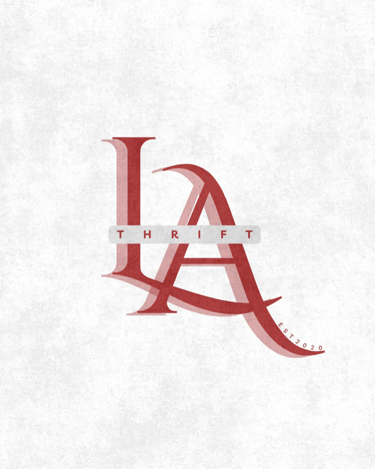
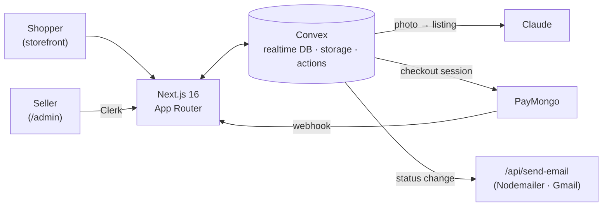

<div align="center">



# LA Thrift

**The online shop and back office for LA Thrift, a Philippine thrift business. Rare gems. Branded. Affordable. Est. 2020.**


[](https://www.tiktok.com/@l.athrift)
[](https://www.instagram.com/la.thrifttttt)
[](https://www.facebook.com/l.athriftt)

</div>

---

## The problem

Thrifting online in the Philippines usually runs on DMs: *"hm po?"*, *"mine!"*, a screenshot of a GCash receipt, and a spreadsheet where someone types the tracking number by hand.

LA Thrift replaces those DMs with a real shop. Buyers browse, check out and pay on their own. The seller lists a new find by taking a photo, and AI drafts the listing.

## What it does

### 🛍️ For shoppers
- **Browse and filter** by category, with featured items, new arrivals and related picks.
- **Cart drawer** that slides in with Framer Motion, so you never leave the page you're browsing.
- **Checkout with PayMongo:** GCash, Maya or QR Ph. Cash on delivery and TikTok checkout are options too.
- **Shipping choices that fit the Philippines:** Lalamove, GoGo Xpress, TikTok, or a flat rate.
- **Branded order emails** for each status change (paid, shipped, delivered), with a tracking link for J&T, LBC, Flash, Ninja Van or GoGo Xpress.

### 🧑‍💼 For the seller (`/admin`, behind Clerk)
- **List an item from a photo.** Upload up to two shots, and Claude drafts the name, brand, condition, category and description. The seller checks it and saves.
- **iPhone photos just work.** HEIC images are converted to JPEG in the browser before upload.
- **Orders, customers and categories** in one dashboard, with sales stats and recent orders.
- **One-of-a-kind vs. stock items.** A `unique` item has a quantity of one, and a `stock` item counts down. Either one flips to sold when it runs out, and goes back on sale if the order is cancelled.

## How it fits together



- **Convex** holds products, orders, customers and images. Queries are reactive, so the admin dashboard updates live when an order comes in, with no refresh and no polling.
- **PayMongo** creates the hosted checkout. Its webhook marks the order paid and records the payment reference.
- **Claude** runs inside a Convex action, so the API key stays on the server. Images are passed by URL rather than as base64, which keeps the action's memory use low.

## Tech stack

| | |
|---|---|
| **Frontend** | Next.js 16 (App Router), React 19, Tailwind CSS 4, Framer Motion, Lucide |
| **Backend** | Convex (database, file storage, server actions) |
| **Auth** | Clerk, protecting `/admin` through middleware |
| **Payments** | PayMongo Checkout and webhooks |
| **AI** | Anthropic Claude (vision) |
| **Email** | Nodemailer over Gmail SMTP |

## Running it locally

```bash
npm install
npx convex dev      # creates a Convex project and writes NEXT_PUBLIC_CONVEX_URL
npm run dev
```

Add these to `.env.local` (Next.js):

```bash
NEXT_PUBLIC_CONVEX_URL=
NEXT_PUBLIC_CLERK_PUBLISHABLE_KEY=
CLERK_SECRET_KEY=
PAYMONGO_WEBHOOK_SECRET=
GMAIL_USER=
GMAIL_APP_PASSWORD=     # a Gmail app password, not your real one
```

And set these in the Convex dashboard, because Convex actions read their own environment:

```bash
CLERK_JWT_ISSUER_DOMAIN=
ANTHROPIC_API_KEY=
PAYMONGO_SECRET_KEY=
SITE_URL=               # where /api/send-email lives
```

## Project layout

```
app/(storefront)/   home, shop, product page, checkout (+ success / cancel)
app/admin/          dashboard, products, orders, customers, categories
app/api/            send-email, PayMongo webhook
convex/             schema, queries, mutations, and the AI + payment actions
components/         storefront, admin and UI building blocks
hooks/useCart.tsx   cart state
```

---

<div align="center">
<sub>Built for <b>LA Thrift</b> · Follow the drops on <a href="https://www.tiktok.com/@l.athrift">TikTok</a>, <a href="https://www.instagram.com/la.thrifttttt">Instagram</a> and <a href="https://www.facebook.com/l.athriftt">Facebook</a></sub>
</div>
